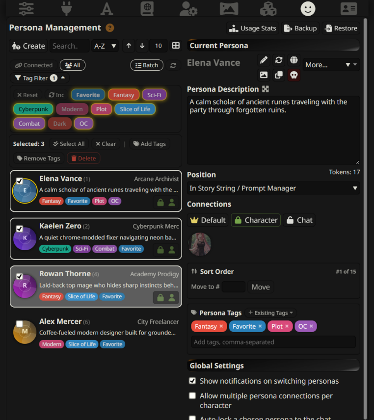

[简体中文](../README.md) | [English](README.en.md) | [繁體中文](README.zh-TW.md) | [Русский](README.ru.md) | [한국어](README.ko.md) | [Español](README.es.md) | **Português (BR)** | [Deutsch](README.de.md) | [Français](README.fr.md) | [ไทย](README.th.md) | [Tiếng Việt](README.vi.md) | [Bahasa Indonesia](README.id.md) | [العربية](README.ar.md)

# Persona Tags

Uma extensão aprimorada de gerenciamento de personas para o SillyTavern.

Quando a sua lista de personas cresce muito, rapidamente fica difícil lembrar quem é quem. Esta extensão permite adicionar tags às personas, filtrar por tags, gerenciar em lote e reordenar livremente para manter tudo organizado e fácil de encontrar.

| Visão geral e seletor de tags | Filtro por tags e modo em lote |
| :---: | :---: |
|  |  |

## Recursos

### Sistema de tags
- Adicione tags às personas (separadas por vírgula para adicionar várias de uma vez)
- Seletor rápido expansível **Tags existentes** na coluna direita (oculta automaticamente as tags que já estão na persona atual, com rolagem suave quando você tem muitas tags)
- Filtre personas por tags nos modos **Incluir** (mostrar apenas as correspondentes) e **Excluir** (ocultar as correspondentes)
- Pressione e segure as tags no painel de filtro para arrastá-las e reordená-las
- As tags usadas por personas vinculadas ao personagem atual ganham um brilho sutil
- Exibe as tags diretamente em cada cartão de persona
- Adicione tags iniciais já na janela de criação de persona

### Gerenciamento em lote
- Clique em **Em lote** para entrar no modo de edição em lote com caixas de seleção em cada cartão
- Selecionar tudo / Limpar seleção
- Adicione tags em lote, remova tags em lote e apague personas em lote

### Ordenação e organização
- Pressione e segure os cartões de persona para arrastar e reordenar (compatível com celular)
- Digite o número exato da posição na coluna direita para ir diretamente até ela
- Exibe o índice da posição atual em cada cartão
- Ordens independentes para **Todos** os perfis de persona e para as personas vinculadas a cada personagem ou grupo individualmente

### Visualizações e navegação
- Visualização **Conectados**: mostra apenas as personas vinculadas ao personagem/grupo atual
- Visualização **Todos**: mostra todas as personas
- Botões superiores **↑ / ↓** de salto rápido: pule uma quantidade personalizada de personas (padrão `10`, salvo entre sessões); segure por `0,5 s` para ir direto ao topo ou ao fim da lista
- Botão de atualização manual para recarregar a lista
- Compatível com visualização em lista e em grade

### Localização e mais
- Suporte completo para todos os **17 idiomas oficiais da interface do SillyTavern**, seguindo automaticamente o idioma configurado no SillyTavern (com fallback para o inglês em idiomas não suportados ou futuros)
- Caixas de seleção opcionais para **Copiar tags** e **Copiar vínculos** ao duplicar uma persona
- Janela aprimorada de seleção múltipla exibindo avatar, nome e tags quando várias personas estão vinculadas ao mesmo personagem
- O backup e a restauração de personas incluem automaticamente tags, ordens personalizadas e configurações de rolagem rápida

## Instalação

### Método 1: Instalar pelo SillyTavern (Recomendado)

1. Abra o SillyTavern e clique em **Extensões** (o ícone de cubos na barra superior)
2. Clique em **Instalar extensão**
3. Cole a URL do repositório abaixo, instale e recarregue a página:

```
https://github.com/XiaoBai20001212/persona-tags
```

> Atualizações futuras podem ser instaladas diretamente em **Gerenciar extensões**.

### Método 2: Instalação manual

Baixe e extraia o repositório e, em seguida, coloque a pasta `persona-tags` inteira em:

```
SillyTavern/public/scripts/extensions/third-party/persona-tags/
```

Recarregue a página e pronto, já pode usar.

## Armazenamento de dados

Os dados de tags e ordenação ficam salvos em `extension_settings` do SillyTavern, sem modificar seus dados originais de persona. Remover a pasta da extensão restaura a interface padrão de forma limpa, sem afetar o SillyTavern.

## Autores

- [小白](https://github.com/XiaoBai20001212)
- [好大一只鱼](https://github.com/haodayizhiyu404)
