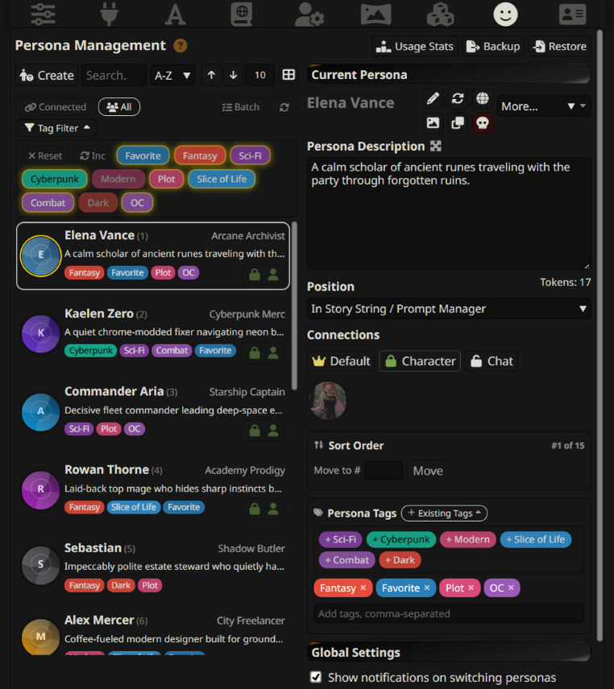

[简体中文](../README.md) | [English](README.en.md) | [繁體中文](README.zh-TW.md) | [Русский](README.ru.md) | [한국어](README.ko.md) | [Español](README.es.md) | [Português (BR)](README.pt-BR.md) | [Deutsch](README.de.md) | [Français](README.fr.md) | [ไทย](README.th.md) | **Tiếng Việt** | [Bahasa Indonesia](README.id.md)

# Persona Tags

Tiện ích mở rộng quản lý Persona nâng cao dành cho SillyTavern.

Khi danh sách Persona ngày càng nhiều, việc nhớ ai là ai trở nên khó khăn hơn rất nhanh. Tiện ích này giúp bạn gắn thẻ Persona, lọc theo thẻ, quản lý hàng loạt và tự do sắp xếp lại thứ tự để mọi thứ luôn gọn gàng, dễ tìm.

| Tổng quan & chọn nhanh thẻ có sẵn | Lọc theo thẻ & chế độ hàng loạt |
| :---: | :---: |
|  |  |

## Tính năng

### Hệ thống thẻ
- Thêm thẻ cho Persona (nhập cách nhau bằng dấu phẩy để thêm nhiều thẻ cùng lúc)
- Bộ chọn nhanh **Thẻ hiện có** có thể đóng/mở ở cột bên phải (tự động ẩn những thẻ đã có trên Persona hiện tại, cuộn mượt mà khi có nhiều thẻ)
- Lọc Persona theo thẻ với hai chế độ **Gồm** (chỉ hiện thẻ khớp) và **Trừ** (ẩn thẻ khớp)
- Nhấn giữ thẻ trong bảng lọc để kéo và sắp xếp lại thứ tự
- Các thẻ được dùng bởi Persona đang liên kết với nhân vật hiện tại sẽ phát sáng nhẹ
- Hiển thị thẻ trực tiếp trên từng thẻ Persona
- Thêm thẻ ban đầu ngay trong hộp thoại tạo Persona mới

### Quản lý hàng loạt
- Nhấn **Hàng loạt** để vào chế độ chỉnh sửa hàng loạt với ô đánh dấu trên mỗi Persona
- Chọn hết / Bỏ chọn
- Gắn thẻ hàng loạt, gỡ thẻ hàng loạt và xóa hàng loạt Persona

### Sắp xếp & Thứ tự
- Nhấn giữ thẻ Persona để kéo và sắp xếp lại thứ tự (thân thiện với thiết bị di động)
- Nhập số vị trí chính xác ở cột bên phải để chuyển thẳng tới vị trí đó
- Hiển thị chỉ số vị trí hiện tại trên mỗi thẻ Persona
- Lưu thứ tự sắp xếp độc lập cho danh sách **Tất cả** Persona và danh sách Persona đã liên kết của từng nhân vật/nhóm riêng biệt

### Chế độ xem & Điều hướng
- Chế độ xem **Liên kết**: chỉ hiển thị các Persona đã liên kết với nhân vật hoặc nhóm hiện tại
- Chế độ xem **Tất cả**: hiển thị toàn bộ Persona
- Nút cuộn nhanh **↑ / ↓** ở phía trên: nhảy theo số lượng Persona tùy chỉnh (mặc định `10`, được lưu giữ qua các phiên); nhấn giữ `0.5s` để nhảy thẳng lên đầu hoặc xuống cuối danh sách
- Nút làm mới thủ công để tải lại danh sách
- Hỗ trợ cả chế độ xem danh sách và chế độ xem lưới

### Ngôn ngữ & Tiện ích khác
- Hỗ trợ đầy đủ cả **17 ngôn ngữ giao diện chính thức của SillyTavern**, tự động đồng bộ theo cài đặt ngôn ngữ SillyTavern của bạn (tự động quay về tiếng Anh nếu gặp ngôn ngữ chưa hỗ trợ hoặc ngôn ngữ mới sau này)
- Tùy chọn đánh dấu **Sao chép thẻ** và **Sao chép liên kết** khi nhân bản một Persona
- Cửa sổ chọn nhiều Persona được nâng cấp, hiển thị ảnh đại diện, tên và thẻ khi có nhiều Persona cùng liên kết với một nhân vật
- Sao lưu và khôi phục Persona tự động bao gồm thẻ, thứ tự sắp xếp tùy chỉnh và thiết lập cuộn nhanh

## Cài đặt

### Cách 1: Cài đặt trực tiếp trong SillyTavern (Khuyên dùng)

1. Mở SillyTavern và nhấp vào **Tiện ích** (biểu tượng các khối lập phương trên thanh công cụ phía trên)
2. Nhấp vào **Cài đặt tiện ích**
3. Dán URL kho lưu trữ bên dưới, tiến hành cài đặt rồi tải lại trang:

```
https://github.com/XiaoBai20001212/persona-tags
```

> Các bản cập nhật sau này có thể được cài đặt trực tiếp từ **Quản lý tiện ích**.

### Cách 2: Cài đặt thủ công

Tải xuống và giải nén kho lưu trữ, sau đó đặt toàn bộ thư mục `persona-tags` vào đường dẫn:

```
SillyTavern/public/scripts/extensions/third-party/persona-tags/
```

Tải lại trang là bạn đã có thể sử dụng ngay.

## Lưu trữ dữ liệu

Dữ liệu thẻ và thứ tự sắp xếp được lưu trong `extension_settings` của SillyTavern mà không làm thay đổi dữ liệu Persona gốc của bạn. Khi xóa thư mục tiện ích mở rộng, giao diện mặc định sẽ được khôi phục nguyên vẹn mà không ảnh hưởng đến SillyTavern.

## Tác giả

- [小白](https://github.com/XiaoBai20001212)
- [好大一只鱼](https://github.com/haodayizhiyu404)
