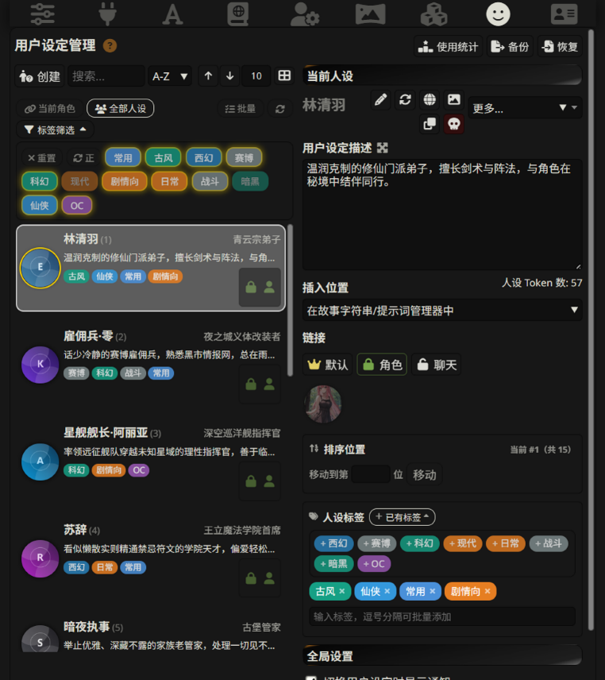
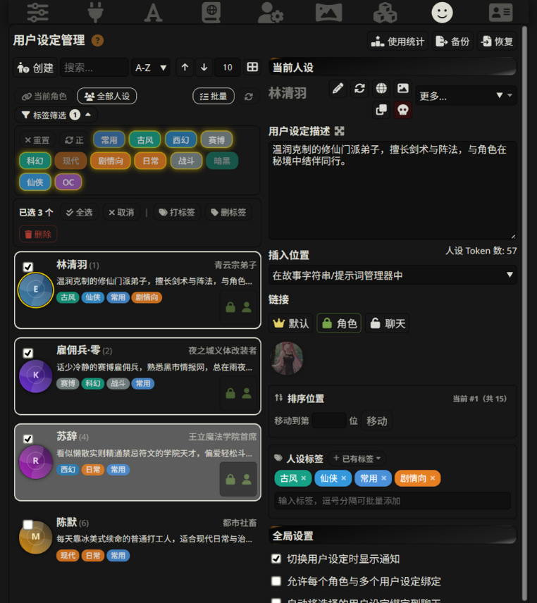

[简体中文](../README.md) | [English](README.en.md) | **繁體中文** | [Русский](README.ru.md) | [한국어](README.ko.md) | [Español](README.es.md) | [Português (BR)](README.pt-BR.md) | [Deutsch](README.de.md) | [Français](README.fr.md) | [ไทย](README.th.md) | [Tiếng Việt](README.vi.md) | [Bahasa Indonesia](README.id.md) | [العربية](README.ar.md)

# Persona Tags

SillyTavern 人設管理增強擴充功能。

人設一多就容易亂，常常分不清誰是誰。這個擴充功能讓你可以為人設加標籤、依標籤篩選、批次管理、拖曳排序，把雜亂的人設清單整理得井井有條。

| 主介面與已有標籤快選 | 標籤篩選與批次管理 |
| :---: | :---: |
|  |  |

## 功能

### 標籤系統
- 為人設加上標籤，用逗號分隔即可一次新增多個
- 右欄「已有標籤」可展開點選既有標籤快速套用（自動隱藏目前人設已有的標籤，標籤多時支援捲動）
- 依標籤篩選人設，支援正向（只顯示符合的）與反向（隱藏符合的）兩種模式
- 在篩選面板中長按標籤即可拖曳排序
- 與目前角色卡綁定的人設，其標籤會微微發亮提示
- 人設卡片上直接顯示標籤
- 建立人設時可直接一併填寫標籤

### 批次管理
- 點選「批次」按鈕進入批次模式，卡片上會出現勾選框
- 全選 / 取消全選
- 批次加標籤、批次刪標籤、批次刪除人設

### 排序
- 長按人設卡片即可拖曳排序（手機端同樣支援）
- 在右欄輸入位置數字即可精確移動到指定順位
- 每張卡片直接顯示目前的排序位號
- 「全部人設」與各角色卡／群組的綁定人設各自保有獨立排序，互不干擾

### 檢視與捲動
- 「目前角色」模式：只顯示與目前角色卡綁定的人設
- 「全部人設」模式：顯示所有人設
- 頂部「↑ / ↓」快捷跳轉捲動：可自訂每次跳過的人設數量（預設 10，永久記住），長按 0.5 秒直達頂部或底部
- 手動重新整理按鈕，隨時刷新清單
- 同時支援清單與網格兩種檢視模式

### 多語言與其他
- 完整支援 SillyTavern 官方全部 17 種介面語言，自動跟隨酒館目前的語言設定（未涵蓋的新語種自動回退為英文）
- 複製人設時可勾選是否一併複製標籤與綁定關係
- 當多個人設綁定至同一張角色卡時，選擇彈窗可直接看到頭像、名稱與標籤
- 備份／還原人設時會自動包含標籤、排序與快捷捲動設定

## 安裝

### 方式一：在 SillyTavern 內直接安裝（推薦）

1. 開啟 SillyTavern，點選頂部選單列的「**擴充功能**」（方塊圖示）
2. 點選「**安裝擴充功能**」
3. 在輸入框中貼上下方儲存庫網址，點選安裝並重新整理頁面即可：

```
https://github.com/XiaoBai20001212/persona-tags
```

> 後續有新版本時，可直接在「**管理擴充功能**」中一鍵更新。

### 方式二：手動安裝

下載儲存庫壓縮檔並解壓縮，將整個 `persona-tags` 資料夾放到：

```
SillyTavern/public/scripts/extensions/third-party/persona-tags/
```

重新整理頁面即可開始使用。

## 資料儲存

標籤與排序資料保存在 SillyTavern 的 `extension_settings` 中，不會改動原本的人設資料。移除擴充功能資料夾即可恢復原狀，不會影響 SillyTavern 正常運作。

## 作者

- [小白](https://github.com/XiaoBai20001212)
- [好大一只鱼](https://github.com/haodayizhiyu404)
